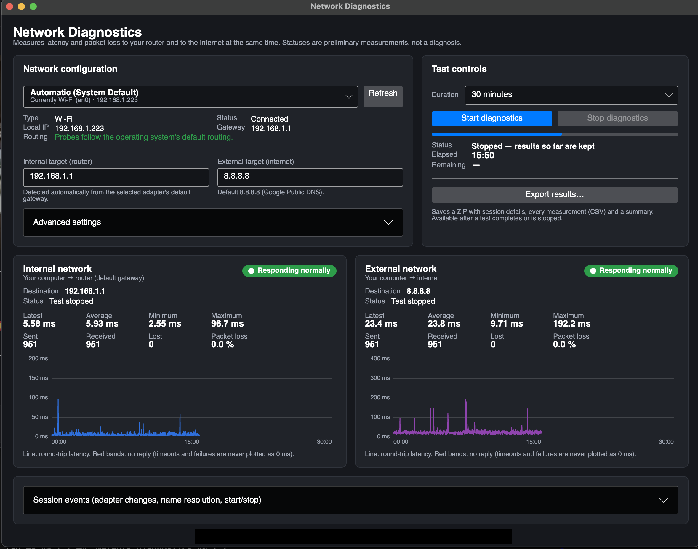

# Network Diagnostics

**Lagging in GTA Online, Counter-Strike 2, Fortnite or Call of Duty? Find out why.**

Network Diagnostics is a free desktop application for Windows and macOS that helps gamers investigate high ping, latency spikes, packet loss and unstable internet connections.

If you're seeing rubberbanding, delayed hit registration, random disconnects or sudden lag in an online match, Network Diagnostics helps you work out whether the problem starts on your home network or on your internet connection.

Unlike a one-off speed test, Network Diagnostics monitors your connection for up to 30 minutes at a time, so you can spot intermittent problems that only appear while you play.

[](https://github.com/harryhax/csharp_ping_monitor/releases/latest)
[](https://github.com/harryhax/csharp_ping_monitor/actions/workflows/release.yml)
[](https://github.com/harryhax/csharp_ping_monitor/releases)
[](#installation)
[](https://dotnet.microsoft.com/download/dotnet/10.0)

## Download

**[Download the Latest Release](https://github.com/harryhax/csharp_ping_monitor/releases/latest)**

| Platform | Architecture | Download |
|---|---|---|
| Windows | x64 | [NetworkDiagnostics-win-x64.zip](https://github.com/harryhax/csharp_ping_monitor/releases/latest/download/NetworkDiagnostics-win-x64.zip) |
| macOS | Apple Silicon (ARM64) | [NetworkDiagnostics-osx-arm64.zip](https://github.com/harryhax/csharp_ping_monitor/releases/latest/download/NetworkDiagnostics-osx-arm64.zip) |
| macOS | Intel (x64) | [NetworkDiagnostics-osx-x64.zip](https://github.com/harryhax/csharp_ping_monitor/releases/latest/download/NetworkDiagnostics-osx-x64.zip) |

These links always download the newest release. The version number is shown on the release page and in the badge above.

## Why use Network Diagnostics?

- **Investigate high ping.** Watch latency over time and spot sudden spikes that disrupt online play.
- **Detect packet loss.** Find dropped packets that can cause rubberbanding, stuttering and unstable connections.
- **Separate local problems from internet problems.** Monitor your router and an internet destination at the same time to see where the trouble begins.
- **Troubleshoot Wi-Fi and Ethernet.** Run a test on each network adapter, for example Wi-Fi and then Ethernet, and compare the results.
- **Catch intermittent problems.** Leave a test running while you play to catch issues a short speed test can miss.
- **Review what happened.** Use the latency graphs, the session event log and exported session data to investigate recurring issues.

### Games and applications

Network Diagnostics can help troubleshoot connection problems in online games such as:

- Grand Theft Auto Online (GTA Online)
- Counter-Strike 2 (CS2)
- Fortnite
- Call of Duty / Warzone
- Valorant
- Apex Legends
- Minecraft multiplayer
- Rocket League
- Other online multiplayer games

**How it works:** Network Diagnostics measures your router (local gateway) and an internet destination (`8.8.8.8` by default). This shows whether latency spikes and packet loss happen close to your computer or farther along your connection. It does not measure ping to a game's own servers. You can enter a server's address as the external target, but many game servers do not answer ping requests.

**Important:** Network Diagnostics is a diagnostic tool, not a ping booster, VPN or game network optimizer. It does not change your internet connection or guarantee lower in-game ping. Its purpose is to give you evidence so you can find and fix the underlying problem.

## Features

- **Two targets at once.** Pings the selected adapter's default gateway (*Internal*) and an internet host (*External*, default `8.8.8.8`) at the same time.
- **ICMP ping measurements.** One echo request per second per target. Only one probe per target is in flight at a time, and missed slots are skipped rather than queued.
- **Live statistics.** Latest, average, minimum and maximum latency; sent, received and lost counts; and packet loss %.
- **Live latency graphs.** One per target. Failed probes are drawn as red bands, never as 0 ms.
- **Traffic-light status.** Each target shows a coloured status with a text label, based on the last 20 probes (see [Status rules](#status-rules)).
- **Network adapter selection.** Choose a specific adapter or **Automatic (System Default)**. The app shows the adapter's type, IPv4 address, gateway and connection status. An explicit choice is enforced by binding probes to that adapter, or reported as unsupported. The app never silently uses another adapter and never changes routing tables.
- **Session controls.** Test duration of 1, 5, 10 or 30 minutes, with Start and Stop, elapsed and remaining time, and session status.
- **Network events.** Adapter disconnects, reconnects, address changes, hostname resolution and warnings are logged during the session.
- **Export.** Save a ZIP containing `session.json`, `internal-ping.csv`, `external-ping.csv` and `summary.json`.
- **Saved settings.** Your selections are stored in a local JSON file and restored on startup.

There is no server, account, database or telemetry.

### Local network or internet?

Comparing the two targets shows where a problem is:

| Internal (router) | External (internet) | Likely location of the problem |
|---|---|---|
| Healthy | Healthy | No problem detected |
| Healthy | Failing or slow | Beyond your router: modem, ISP or the remote host |
| Failing or slow | Failing or slow | Your local network: Wi-Fi signal, cable, adapter or router |
| Failing | Healthy | Usually the router ignoring pings, or (on macOS) the Local Network permission; see [Known limitations](#known-limitations) |

The statuses are measurements, not a diagnosis.

## Screenshots



## Installation

Release builds are self-contained, so you do not need to install the .NET runtime.

### Windows

1. Download [`NetworkDiagnostics-win-x64.zip`](https://github.com/harryhax/csharp_ping_monitor/releases/latest/download/NetworkDiagnostics-win-x64.zip).
2. Extract the ZIP to a folder.
3. Run `NetworkDiagnostics.exe`.

The Windows build is not code-signed, so SmartScreen may warn the first time you run it.

### macOS (Apple Silicon)

1. Download [`NetworkDiagnostics-osx-arm64.zip`](https://github.com/harryhax/csharp_ping_monitor/releases/latest/download/NetworkDiagnostics-osx-arm64.zip).
2. Extract the ZIP.
3. Open `NetworkDiagnostics.app`.

### macOS (Intel)

1. Download [`NetworkDiagnostics-osx-x64.zip`](https://github.com/harryhax/csharp_ping_monitor/releases/latest/download/NetworkDiagnostics-osx-x64.zip).
2. Extract the ZIP.
3. Open `NetworkDiagnostics.app`.

### macOS security note

The macOS release builds are ad-hoc signed only. They are not signed with an Apple Developer ID or notarized, so Gatekeeper may say the app cannot be opened or is from an unidentified developer. If you trust the download, try to open the app once, then allow just this app in **System Settings → Privacy & Security** by clicking **Open Anyway**. Do not disable Gatekeeper globally.

When macOS asks to let the app find devices on your local network, choose **Allow**. Without it, pings to your router are blocked (see [Known limitations](#known-limitations)).

## Using the app

1. Choose a network adapter, or leave **Automatic (System Default)**.
2. Check the targets. The internal target is filled in from the adapter's gateway; to override it, open **Advanced settings → Use a manual internal target**. The external target accepts an IPv4 address or a hostname.
3. Pick a duration and press **Start diagnostics**.
4. Press **Stop diagnostics** at any time. Results collected so far are kept.
5. Press **Export results…** to save the ZIP.

### Status rules

Each status is based on the last 20 completed probes. Thresholds are stored in the settings file.

| Status | Rule (first match wins) |
|---|---|
| 🔴 **Not responding** | 3 or more consecutive failures |
| 🔴 **Heavy packet loss** | 20 % or more of the window failed (needs at least 5 samples) |
| 🟡 **Intermittent failures** | any failure in the window |
| 🟡 **Elevated latency** | window average above 30 ms (internal) or 100 ms (external) |
| 🟢 **Responding normally** | otherwise |

### Export contents

| File | Contents |
|---|---|
| `session.json` | Session ID, app version, start and end time (UTC), requested and actual duration, end reason, adapter details, targets, interval, timeout, thresholds, platform, and the event log |
| `internal-ping.csv`, `external-ping.csv` | One row per probe: `session_id, sequence, timestamp_utc, scheduled_offset_ms, sent_offset_ms, adapter_id, adapter_local_ip, target_type, target, resolved_ip, rtt_ms, status, error_detail` |
| `summary.json` | Per target: sent, completed, received, failed, cancelled, loss %, min/avg/max latency, and counts per status |

- Numbers use invariant formatting (`.` as the decimal separator).
- Timestamps are ISO 8601 UTC, for example `2026-11-18T01:11:21.990Z`.
- Failed probes keep their status (`Timeout`, `DestinationUnreachable`, `DnsFailure` and so on) and have an empty `rtt_ms`.
- Packet loss = failed ÷ completed × 100. Probes cancelled by **Stop** are excluded.
- The export includes the adapter's local IPv4 address and gateway. It does not include the machine name, user name or MAC addresses.

A sample report from a real 20-second session is in [docs/sample-report/](docs/sample-report/).

## How adapter binding works

The .NET `Ping` class cannot choose an adapter, so an explicitly selected adapter uses platform-specific code:

| Platform | Explicit adapter | Automatic |
|---|---|---|
| macOS | Unprivileged ICMP socket bound to the interface with `IP_BOUND_IF` | `System.Net.NetworkInformation.Ping` |
| Windows | `IcmpSendEcho2Ex` with the adapter's IPv4 address as the source | `System.Net.NetworkInformation.Ping` |
| Other | Reported as unsupported; use Automatic | `System.Net.NetworkInformation.Ping` |

If binding isn't possible, the **Routing** line turns red and Start reports the reason.

## Building from source

Requirements: the [.NET 10 SDK](https://dotnet.microsoft.com/download/dotnet/10.0).

```bash
git clone https://github.com/harryhax/csharp_ping_monitor.git
cd csharp_ping_monitor

dotnet restore NetworkDiagnostics.sln
dotnet build NetworkDiagnostics.sln
dotnet run --project NetworkDiagnostics.App/NetworkDiagnostics.App.csproj
```

On macOS, `dotnet run` uses the terminal's Local Network permission, so test permission behaviour with a packaged `.app` instead.

### Tests

```bash
dotnet test NetworkDiagnostics.Tests/NetworkDiagnostics.Tests.csproj
```

Unit tests use simulated probes and do not need a network connection. Integration tests that use the real network are skipped unless you opt in:

```bash
ND_INTEGRATION=1 dotnet test NetworkDiagnostics.Tests/NetworkDiagnostics.Tests.csproj --filter Category=Integration
```

### Packaging locally

```bash
scripts/publish-macos.sh osx-arm64      # artifacts/osx-arm64/Network Diagnostics.app (ad-hoc signed)
scripts/publish-macos.sh osx-x64        # Intel
pwsh scripts/publish-windows.ps1 -Rid win-x64   # artifacts/publish/win-x64/NetworkDiagnostics.exe
```

Official releases are built by the [Release workflow](.github/workflows/release.yml) when a `v*` tag (for example `v0.1.2`) is pushed. It runs the tests, creates the versioned GitHub release, then publishes, ad-hoc signs (macOS) and uploads three ZIPs with fixed names: `NetworkDiagnostics-win-x64.zip`, `NetworkDiagnostics-osx-arm64.zip` and `NetworkDiagnostics-osx-x64.zip`. The fixed names keep the README download links working for every release.

## Technology stack

- C# and .NET 10
- [Avalonia UI](https://avaloniaui.net/) 12 (Fluent theme) for the cross-platform desktop UI
- [CommunityToolkit.Mvvm](https://github.com/CommunityToolkit/dotnet) for the MVVM view models
- Microsoft.Extensions.DependencyInjection
- Platform networking: `System.Net.NetworkInformation`, BSD ICMP sockets on macOS, and `iphlpapi` (`IcmpSendEcho2Ex`) on Windows
- xUnit for tests
- A custom Avalonia control for the latency graph (no charting library)

## Known limitations

- **macOS Local Network permission.** On macOS 15 and later, packets to the router are silently dropped until you allow the app to access the local network. The router then looks unreachable (100 % internal loss) while the internet works. The app pings the gateway once at startup so the prompt appears early, and shows a banner if the router never replies but the internet does. To change your answer, go to **System Settings → Privacy & Security → Local Network**.
- **Windows adapter binding is untested on Windows hardware.** It relies on Windows' default strong host send model. An interface with `weakhostsend` enabled could route differently.
- **Secondary adapters on macOS.** Gateway detection has been verified only for the primary adapter.
- **DNS** uses the system resolver and is not bound to the selected adapter.
- **IPv4 only.** IPv6 targets are rejected, and adapters without an IPv4 address are not listed.
- Some routers deprioritise ICMP, which can inflate gateway latency.

## Project layout

```text
NetworkDiagnostics.Core/    UI-free engine: models, monitoring, statistics, export, settings
NetworkDiagnostics.App/     Avalonia UI, view models, and platform probes (Platforms/MacOS, Platforms/Windows)
NetworkDiagnostics.Tests/   xUnit unit tests and opt-in integration tests
scripts/                    Local packaging scripts
docs/sample-report/         Example exported report
.github/workflows/          Release workflow
```

## Releases

- [Latest release](https://github.com/harryhax/csharp_ping_monitor/releases/latest)
- [All releases](https://github.com/harryhax/csharp_ping_monitor/releases)
- [Release workflow runs](https://github.com/harryhax/csharp_ping_monitor/actions/workflows/release.yml)
- [Issues](https://github.com/harryhax/csharp_ping_monitor/issues)

## Contributing

To report a bug, [open an issue](https://github.com/harryhax/csharp_ping_monitor/issues). Include your operating system and version, the adapter type (Wi-Fi or Ethernet), what you expected and what happened. An exported results ZIP helps; check it first, because it contains your local IP address and gateway.

To propose a change, open an issue to discuss it first, then send a pull request. Make sure `dotnet test` passes.

## License

No license has been added to this repository yet.
